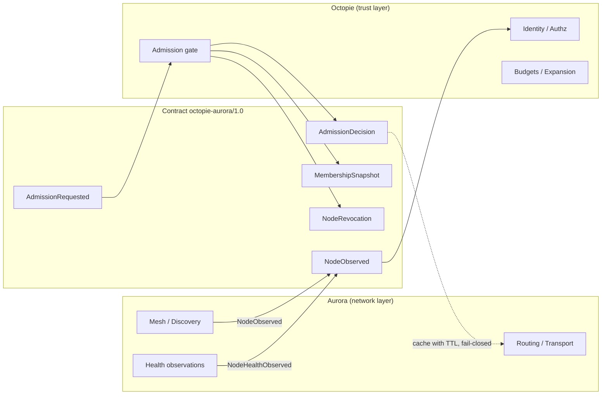

# Octopie ↔ Aurora Integration Contract

**Contract version:** `octopie-aurora/1.0`

## Division of responsibility



| State | Authority |
|-------|-----------|
| Network reachability, routes, delivery | **Aurora** |
| Trusted membership, admission, revocation | **Octopie** |
| Authorization / capability policy | **Octopie** |
| Resource budgets, expansion limits | **Octopie** |
| Artifact integrity / history | **Aurora** |
| Integration health | Shared (`CoordinationStatus`) |

**Hard rule:** transport success is never admission. Discovery is never trust.

## Message types

| Message | Direction | Purpose |
|---------|-----------|---------|
| `NodeObserved` | Aurora → Octopie | Peer seen; not a trust claim |
| `AdmissionRequested` | Aurora → Octopie | Ask for a decision |
| `AdmissionDecision` | Octopie → Aurora | Admit / reject / defer / revoke |
| `MembershipSnapshot` | Octopie → Aurora | Admitted node IDs only |
| `CapabilityDecision` | Octopie → Aurora | Capability grant/deny |
| `NodeHealthObserved` | Aurora → Octopie | Advisory health |
| `NodeRevocation` | Octopie → Aurora | Immediate trust removal |
| `CoordinationStatus` | Either | Boundary health |

Every decision includes: `node_id`, `outcome`, `reason_code`, `policy_version`, `contract_version`, `decided_at`, `correlation_id`, optional `expires_at`.

## Trust outcomes

- `observed_unverified`
- `authenticated_not_authorized`
- `authorized_not_admitted`
- `admitted_active`
- `degraded` / `isolated` / `revoked` / `rejected`

## Behaviour on failure

| Condition | Required behaviour |
|-----------|-------------------|
| Incompatible `contract_version` | Reject (`ContractError`) |
| Missing credential on admission request | Reject (`missing_credential`) |
| Expired decision (`expires_at`) | Aurora must not treat as valid trust |
| Duplicate `correlation_id` | Idempotent; no double membership |
| Octopie unavailable | Aurora pauses **new** security-sensitive admissions; existing authorized work continues only within Aurora's own already-configured boundaries |
| Malformed payload | Reject; do not grant privileges |

## Safe defaults

- Integration **disabled / observe-only** until explicitly configured on Aurora.
- No automatic enrollment of unknown public peers.
- Peer recommendations never bypass Octopie authorization.
- Secrets never appear in contract messages or logs.

## Running isolated tests

```bash
cd Octopie
pip install -e ".[dev]"
pytest tests/test_aurora_contract.py tests/test_head_architecture.py -q
```

## Enabling on Aurora

See Aurora `docs/OCTOPIE_INTEGRATION.md`. Set observe-only off only after contract version match, decision TTL, and revocation path are verified.
